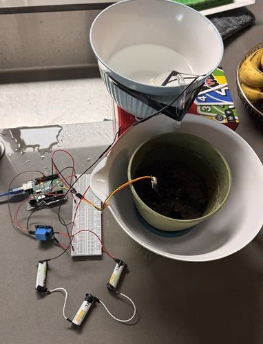
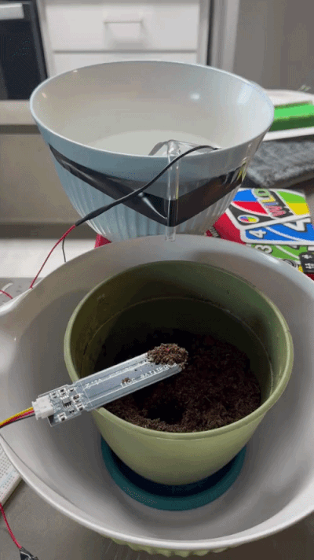

# AutomatedPlantWater

Overview

This project uses an Arduino Uno R3, a capacitive soil moisture sensor, a relay module,
and a 2-6V DC submersible pump to autonomously water plants.

Hardware Used
* Arduino Uno R3
* Capacitive Soil Moisture Sensor v1.2
* Relay Module
* DC 2-6V submersible water pump
* Breadboard
* Jumper Wires
* AA batteries

Skills Demonstrated
* Embedded C++ 
* Reading analog inputs
* Writing digital outputs
* Circuit design
* Troubleshooting and debugging

How it works

The Arduino continuously reads the soil moisture sensor's analog output. When moisture levels drop below 50%, the relay is activated, powering the submersible pump and watering the plant. Once the desired moisture level is reached, the pump is turned off automatically.

Results

Successfully automated plant watering based on soil moisture measurements, reducing the need for manual watering and demonstrating closed-loop control using sensor feedback.

Images

Future Improvements

* Dedicated harness for external power
* Purpose built water delivering tube
* Independent power supply for Arduino
